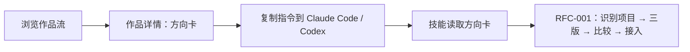

# RFC-002 · 设计方向库：从"看到喜欢的"到"在自己项目里出三版"

- 状态：已接受（2026-10-27），P0–P3 已实施。P3 的实测见 `docs/research/2026-10-27-direction-card-dogfood.md`。
- 更新：2026-10-27。
- 关联：RFC-001；PRD-006、007；Issue #40、#44。
- 参考：recent.design 公开页面（首页、`/skills`、`/info`），2026-10-27 按普通访客方式阅读。只记录它公开呈现的形态，不抓取、不复制内容。

## 1. 核心决策

把网站从"营销页加若干演示"改成一个**设计方向库**：持续更新、宁缺毋滥的作品流。每件作品都附带一张可执行的**方向卡**，用户复制一条指令，就能让自己的 agent 用 Variant Design 在真实项目里按这个方向出 A/B/C。

recent.design 解决的是"去哪里看好设计"，它只能看、不能用。我们把浏览接到 RFC-001 的工作流上，网站负责被发现和带来流量，技能负责交付。这样内容产品服务于核心工作流，不会变成第二个产品。



## 2. 参考对象的公开形态

| 方面 | recent.design | 本库的取舍 |
|---|---|---|
| 首页 | 按分类的作品流（界面、品牌、动效、插画、海报、发布视频、网站、App 图标等），署名作者，部分作品是多图轮播 | 采用作品流和署名。分类收窄到我们能交付的：落地页、产品界面、品牌、组件、数据展示 |
| 资源 | Tools、Skills、Jobs。Skills 按 `作者/仓库` 列出，配一句话说明、安装按钮（skills.sh）和安装量 | 做 `/skills`，但只收录与设计交付相关、我们实际试过的技能，并写明试用结论 |
| 策展 | "quality over quantity"，没有公开投稿和授权政策 | 同样宁缺毋滥，但必须公开投稿和授权规则（见第 5 节） |
| 商业 | 赞助位、招聘 | 本阶段不做。等流量有了证据再评估 |
| 交付 | 无 | **差异点**：每件作品都能在用户自己的项目里试 |

## 3. 现状与差距

| 现状 | 问题 |
|---|---|
| 单页应用，整站只有一个 `index.html`，标题固定 | 作品没有独立网址、标题、描述和分享卡片。搜索引擎和社交平台看到的每一页都一样，内容站失去最主要的流量来源 |
| 灵感数据在 `website/src/inspiration-data.ts`，24 条 | 全部标注 `reference-only; no redistribution permission established`，却以截图形式托管在 `public/inspiration/`。小规模演示时风险有限，变成公开内容站后不可接受 |
| 案例写死在 `ContentPages.tsx` 的 `cases`（3 条）里 | 没有统一结构，新增要改组件代码 |
| 七个入口：首页、`/inspiration`、`/showcase`、`/directions`、`/docs`、`/workbench`、`/canvas` | 定位分散。工作台和画布各有一套生成器，与技能重复 |
| 线上开放模型接口（#38） | 公开站点替所有访客付模型费用（#40）。方向库不需要在网站上生成 |

## 4. 信息架构

| 路径 | 内容 |
|---|---|
| `/` | 作品流：精选在前，按分类筛选，无限滚动或分页 |
| `/d/:slug` | 作品详情：多图、署名、出处、方向卡、"在你的项目里试试"、相关作品 |
| `/c/:category` | 分类页 |
| `/skills` | 精选设计技能，Variant Design 本身排第一 |
| `/docs` | 安装与使用（保留现有内容） |
| `/lab/workbench`、`/lab/canvas` | 现有工作台和画布，标为实验，不再扩展 |
| `/submit` | 投稿说明（走 GitHub PR，见第 6 节） |

旧路径 `/inspiration`、`/showcase`、`/directions` 做 301 跳转到新路径，旧链接不失效。

## 5. 内容来源与授权

每件作品必须属于下面三类之一，构建时校验：

| 类别 | 说明 | 能否托管图片 |
|---|---|---|
| `own` | 用 Variant Design 在示例项目里实际跑出来的方向，附 `variant-output` 证据 | 可以 |
| `permission` | 作者授权的投稿，PR 里附授权声明，并记录授权人和日期 | 可以，按授权范围 |
| `link-only` | 公开作品，只有文字分析，加原站链接 | **不托管截图**。卡片用文字和配色排版，不放对方的图 |

第一阶段只上线 `own` 和 `permission`。现有 24 条灵感全部降为 `link-only`，并移除托管的截图。这是上线内容站之前必须完成的第一件事。

## 6. 数据模型

一条作品对应**一个任务和它的 A/B/C 三个方向**。这是技能的核心单位，也对应 recent.design 的多图轮播。作品存放在 `website/content/entries/<slug>.json`，图片放在 `website/content/media/<slug>/`。没有放在仓库根目录，是因为仓库本身就是被安装的技能，图片放在根目录会让每个用户的技能安装都变大。新增和修改都走 PR，审核就是代码评审。

```json
{
  "slug": "variant-site",
  "title": ["…", "…"], "summary": ["…", "…"], "brief": ["…", "…"],
  "category": "landing", "tags": ["…"],
  "source": "own", "kind": "verified",
  "credit": { "name": "Variant Design", "url": "https://github.com/YuqingNicole/variant-design-skill" },
  "directions": [
    { "id": "A", "name": ["…", "…"],
      "comparison": { "optimizes": ["…", "…"], "tradeoff": ["…", "…"], "bestFor": ["…", "…"] },
      "media": [{ "file": "a.jpg", "width": 1440, "height": 900, "alt": ["…", "…"] }] }
  ],
  "recommendation": { "variant": "B", "reason": ["…", "…"] },
  "evidence": { "context": "website/variant-output/.variant-context.json" },
  "featured": true, "publishedAt": "2026-10-27"
}
```

- 双语字段沿用网站已有的 `[zh, en]` 顺序。
- `own` 作品分两类：
  - `verified`：技能实际跑出来的，`evidence.context` 指向仓库里的 `.variant-context.json`。
  - `concept`：我们手工做的概念演示，页面上明确标注，不声称是技能产出。
- `comparison` 沿用技能 `.variant-context.json` 里每个方向的 `comparison`（`optimizes`、`tradeoff`、`bestFor`，见 `references/project-context.md`）。`verified` 作品的中文必须与记录逐字一致，推荐方向也必须一致，防止事后改写。
- 作品只记录推荐，不记录"选定"。与技能"修改不等于选定"的规则一致。
- 校验在 `website/scripts/content.mjs`，测试在 `content.test.mjs`，由 `npm test --prefix website` 运行，CI 已覆盖。校验内容包括：
  - 必填字段齐全，各来源的托管规则；
  - 授权记录；
  - 图片存在、格式和文件名合法，实际尺寸与记录一致，单张不超过 400 KB；
  - 证据路径不能指向仓库之外。

## 7. 渲染与部署

- **静态生成**：保留 Vite 加 React，构建时用 `react-dom/server` 为每个路由预渲染一份 HTML，写入各自的标题、描述、canonical 和 Open Graph 信息，浏览器端再接管交互。不迁移框架，现有组件和测试都保留。
  - 只有当预渲染在路由数量或增量更新上撑不住时，才评估迁到 Astro。
- **分享图**：第一阶段直接用作品首图，按 1200×630 裁切；`link-only` 作品用文字排版生成分享图。
- **sitemap 和 RSS**：构建时生成。
- **图片**：仓库里只放已优化的 WebP，校验脚本限制体积。响应式 `srcset` 放到第二阶段。
- **部署**：保持 Vercel 静态部署。网站不再需要模型。公开站点的模型接口默认关闭：只有设置 `PUBLIC_MODEL_ROUTES=1` 时，函数才处理生成请求，否则一律返回 404。这样 #40 的费用风险就不存在了。本地运行不受影响。

## 8. "在你的项目里试试"

详情页给出一条可以直接粘贴的指令，例如：

```
用 variant-design 参考 https://variant-design-skill.vercel.app/d/evidence-first-saas-hero.json 的方向，
给我项目的首页出三版：一版贴近这个方向，两版作为对照。给出有理由的推荐，但不替我选定。
```

- 每件作品在构建时同时发布 `/d/:slug.json` 方向卡（`format: "variant-direction-card"`，`version: 1`）。内容包括：
  - 任务和三个方向的说明、推荐；
  - 截图的绝对地址；
  - 复用条款：方向卡只用作灵感，不授予任何复用权。
- 技能用 `scripts/direction-card.mjs` 读取方向卡，再转换成现有任务单里的 `brief.designReferences` 记录：`usage: inspiration`，`review.status: unverified`。默认借鉴推荐方向，让项目的 A 贴近它，B 和 C 作为对照。
- 技能的说明文档是 `references/direction-cards.md`，由生成流程引用。优先级不变：用户约束 → 现有设计系统 → 可访问性 → 方向卡。在没有网络的沙箱里，会请用户粘贴方向卡或保存成文件，不凭印象重建。
- 网站的测试直接用技能的校验器检查构建出来的方向卡，保证两边的格式一致。
- `link-only` 作品的方向卡只包含我们自己写的分析，不包含对方的素材。

## 9. 分期与验收

| 阶段 | 内容 | 验收 |
|---|---|---|
| P0 授权清理（已完成） | 24 条灵感降为 `link-only`，移除托管截图；写出投稿和授权规则 | 仓库当前版本中没有未授权的第三方截图；`/submit` 有公开规则；Playwright 检查灵感页不请求任何第三方图片 |
| P1 数据与校验（已完成） | `website/content/` 结构、校验脚本接入 CI；迁入网站自身的 A/B/C 和两个概念案例；在一次性项目里用技能实际产出产品界面和数据展示各一件 | 覆盖落地页、产品界面、数据展示；至少 3 件 `verified` 作品，证据与记录逐字一致；概念作品明确标注 |
| P2 静态页面（已完成） | 作品流、详情页、分类页、预渲染、分享图、sitemap、RSS、旧路径跳转 | 每个详情页的 HTML 里直接包含各自的标题和描述；Playwright 覆盖作品流、详情页、手机宽度和旧路径跳转 |
| P3 方向卡进入工作流（已完成） | `/d/:slug.json`、`references/direction-cards.md`、"试试"指令 | 在一个一次性项目里，用 Claude Code 和 Codex 各跑一次：技能读取方向卡，出 A/B/C，并且没有覆盖项目的品牌约束。结果记录到 `docs/research/` |
| P4 技能目录与分发 | `/skills`；申请收录到 recent.design Skills 栏目和 skills.sh | 目录上线；收录申请已提交（不把"已提交"说成"已收录"） |
| 之后 | 投稿量、赞助位 | 有流量和投稿的证据后再立项 |

工作台和画布移到 `/lab`，与 P2 一起做。

## 10. 风险

- **偏离核心**：内容站本身很容易做成另一个产品。对策是硬性规定每件作品都必须有能直接使用的方向卡，不能只用来看。
- **内容质量和维护成本**：宁缺毋滥意味着更新慢。对策是先用自产作品撑起内容，让 `own` 作品顺便成为技能的回归样本。
- **版权**：P0 必须先完成。投稿授权要有记录，有人提出撤下请求时，按流程处理并留痕。
- **把展示当成效果证明**：展示页上好看，不等于在用户项目里好用。详情页只陈述实际跑过的证据，不写"提升转化"之类没有验证过的说法。

## 10a. P2 实施说明（2026-10-27）

- **路由**：`/` 是作品流，另有 `/c/:category` 分类页和 `/d/:slug` 详情页，原首页移到 `/about`，工作台和画布在 `/lab`。
- **旧路径**：`/showcase` 和 `/showcase/:id` 用 301 跳转到新页面；`/canvas`、`/workbench` 分别跳转到 `/lab/canvas`、`/lab/workbench`。本地运行时由前端改写地址。
- **保留未动的路径**：
  - `/showcase?direction=` 和 `/directions` 是概念作品的可交互页面，保留不动；
  - `/inspiration` 继续作为仅链接的外部参考页。
- **预渲染**：没有在构建时运行 React 组件，因为这些组件在渲染时会读取浏览器状态。改为构建后由 `website/scripts/prerender.mjs` 直接从作品数据生成：
  - 每个页面带独立的标题、描述、canonical 和分享信息，正文是可直接阅读的 HTML；
  - 浏览器加载后由 React 接管页面；
  - 没有独立页面的路由使用原始外壳 `app.html`，不会继承作品流的元信息。
- **分享图**：暂时直接使用推荐方向的截图（1440×900），没有裁切成 1200×630，避免引入图片处理依赖。
- **模型接口**：公开站点默认关闭，见第 7 节。

## 11. 决定（2026-10-27）

1. P0 移除现有第三方截图：已执行。仓库中原有 22 张截图和来源清单已删除，24 条参考全部标为 `link-only`，改用文字卡片展示，并上线 `/submit` 投稿与授权规则和 GitHub Issue 模板。截图仍保留在 Git 历史中；是否改写历史，另行决定。
2. 公开站点默认关闭模型接口：同意，随 P2 部署改动一起实施。之后 #39 和 #40 改为可选。
3. 使用独立域名：同意，具体域名待定。
4. 第一批 `own` 作品：落地页、产品界面、数据展示各两件。P1 实施时调整为：一条作品就包含三个方向，所以每类先做一到两条；没有技能产出证据的作品标为概念，不算作已验证。
